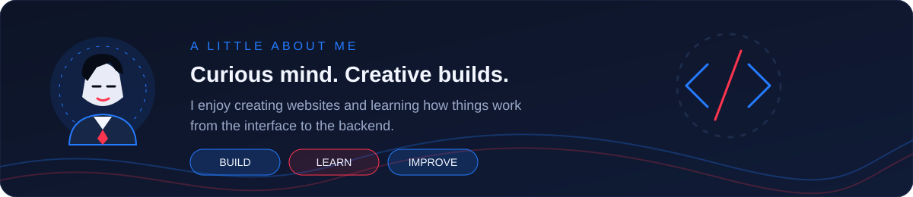
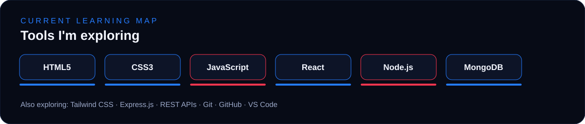
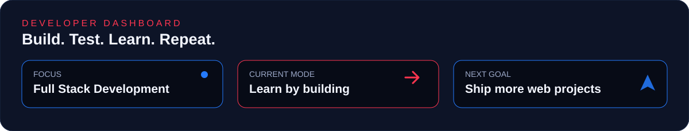

<!-- ARIB PROFILE README — replace this file in your arib-akhtar/arib-akhtar repository -->

  
  &nbsp;&nbsp;
  

 

### Full Stack Developer · Frontend · Backend · Creative Web

**I build websites, explore new technologies, and keep learning by creating.**

📍 Ranchi, India

---

## ✦ About Me

- 💻 Interested in both frontend and backend development
- 🌱 Learning new tools and improving through practical projects
- 🧩 Enjoy creating websites and experimenting with web experiences
- 🎤 Outside coding: speaking, learning new things, and exploring ideas

> **Learning in progress:** the technologies below represent areas I'm learning and exploring, not a claim of expertise in every tool.

## 🚀 Featured Projects

<table>
  <tr>
    <td width="33%" valign="top">
      <h3>01 · Aivon Tech</h3>
      A technology-related web project.
        
      <a href="https://theaivontech.netlify.app/">↗ View live project</a>
    </td>
    <td width="33%" valign="top">
      <h3>02 · Job Portal</h3>
      A web project in the job portal category.
        
      <a href="https://job-portal-2627.vercel.app/">↗ View live project</a>
    </td>
    <td width="33%" valign="top">
      <h3>03 · Amazon Clone</h3>
      An e-commerce website project inspired by Amazon.
        
      <a href="https://clonebrand.netlify.app/">↗ View live project</a>
    </td>
  </tr>
</table>

## 🤝 Let's Connect

**Thanks for visiting my profile.**  
*Keep learning · Keep building · Keep growing*

